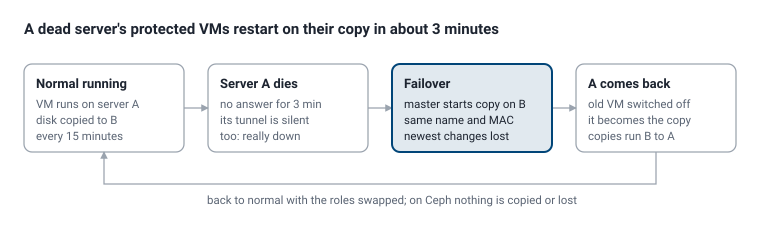

# 12. Cluster, moves and high availability
Summary: Join servers, move VMs (also live), no single master, and high availability.

## Joining servers

Install P8S OS on each machine as usual. The first server is the **master**.

- **Same network:** on the master, Server → Cluster → **Find servers**, pick one, **Invite**; accept on the new server (`p8 cluster find`, `p8 cluster invite NAME`, then `p8 cluster accept` there).
- **Another network (internet):** on the master `p8 cluster add PUBLIC_ADDR`, forward **TCP 8006** and **UDP 51820** to the master, then run the printed `p8 join URL CODE` on the new server. The new server can be behind NAT or CGNAT; the master must be reachable (on CGNAT, use a VPS with a public IP as the master).
- Join codes are single use, expire after an hour and pin the master's certificate. After joining, servers talk only through the WireGuard tunnel (10.250.0.0/24).

New VMs go to the server with the most free RAM, or the one an admin picks. Each worker has a **>\_ Shell** button in Server → Cluster.

## Moving VMs

| Move | How | Time | Notes |
| --- | --- | --- | --- |
| Shut down (local ZFS) | Manage → Options → Move to another server, or `p8 move web1 n2` | Copy of the used disk (1 Gbit/s ≈ 100 MB/s) | UEFI and TPM come along; private IP changes |
| Live (local ZFS) | **Move while running**, or `p8 move web1 n2 --live` | Whole disk + memory (20 GB ≈ 3–4 min at 1 Gbit/s) | Pause under a second. Same CPU, or set `p8 cpu web1 compatible` |
| Ceph, shut down | Same | Instant | No disk copied |
| Ceph, live | Same | Seconds | Only memory moves |

Not yet live: UEFI VMs (Windows 11), SAN-disk VMs, VMs with a public IP or a CD inserted — move those shut down. Snapshots and old backups stay behind; take a new backup after a move.

## No single master (3+ servers)

Every server keeps the *cluster book* (servers, keys, accounts, settings). If the master dies, after about 45 seconds the others elect a new master by **majority** (2 of 3, 3 of 5) and carry on; VMs keep running. The old master rejoins as a worker when it returns. A server cut off from the majority switches its protected VMs off, so a VM never runs twice.

With **two servers** nobody can be outvoted: if the master is really gone, run `p8 cluster promote` on the worker (or the button in Server → Cluster). Only do this when the old master is off for good.

## High availability (HA)

Turn it on per VM: Manage → Options → **High availability**, pick the second server and the copy interval (default 15 minutes, 1–1440).

Nothing has to be done by hand when the dead server returns: it hands its role over and becomes the copy.

- **Local ZFS VMs:** the disk is copied to the second server every interval (only changes after the first copy). On failover, changes after the last copy are lost — pick a short interval for databases.
- **Ceph VMs:** no copies needed; the VM starts from the same disk on another server and nothing is lost.

| VM runs on | Automatic failover |
| --- | --- |
| A worker on the master's LAN | Yes, within about 3 minutes |
| A worker over the internet | No: you get an alert; when sure it's off, Options → High availability → **Start the copy** |
| The master | Yes with 3+ servers (new master starts the copies); with 2: **Start here** on the other server |

Only start a copy by hand when the VM's server is really off (unplug it if unsure), otherwise the VM runs twice with the same disk and IP.
